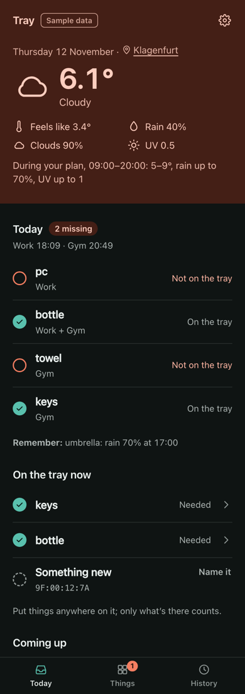

# Tray: never leave without it

A tray by the door that knows what you need today. RFID readers under the tray see which tagged things lie on it,
the tray reads your calendar, and it tells you what's missing: on its LEDs, on a web page, on a full-screen display
and with a push notification on your phone. Built on a Raspberry Pi 3 B+ for a university Pervasive Computing lab.



## What it does

- **Reads your calendar** (any iCal link, e.g. Google Calendar's secret address) every 60 s, Europe/Vienna time,
  with repeating events and cancellations.
- **Works out what to bring.** Lists match words in event titles ("Work" → laptop, bottle; "Gym" → bottle, towel),
  and a `Bring:` / `Porta:` line in the event notes adds things. The day plan is everything needed by today's
  events that haven't ended yet.
- **Checks the tray, every second:** READY, MISSING, IDLE (nothing to bring) or STALE (calendar data too old).
  Things can lie anywhere on the tray: only which tags are read matters.
- **Shows it everywhere:** the Pi's two LEDs (green = ready, red = missing), a phone-friendly web page, a
  full-screen page for a tablet (`/display`, live updates), and a read-only REST API.
- **Notifies you** through [ntfy](https://ntfy.sh):
  - one reminder before the day's first event if something is missing,
  - **bag lifted:** when two or more tags leave the tray within 1.5 s and it's empty, you just picked up your
    bag, and the phone buzzes at once if something is missing. No button to press.
- **Evening mode** (18:00–03:00): it checks **tomorrow's** plan when you put your bag down, and notifies only if
  something is missing.
- **Weather suggestions** from [Open-Meteo](https://open-meteo.com) (free, no key) for the hours of your plan:
  rain → umbrella, hot and sunny → sunglasses, UV → sunscreen, cold → scarf and gloves. Shown as
  "Remember: umbrella (rain 70% at 08:00)". Suggestions never turn the tray red. The rules are editable on the page.
- **Works offline** from its cached calendar and forecast, and says so when the data gets old.
- **Demo controls:** simulated time and simulated weather from the settings page.

## Hardware

| Part | Notes |
|---|---|
| Raspberry Pi 3 B+ | Raspberry Pi OS (trixie), Python 3.13 |
| 3 × MFRC522 RFID reader (13.56 MHz) | one tag per reader at a time |
| RFID tags (MIFARE) | one on each thing you carry |
| The Pi's on-board LEDs | green ACT and red PWR show the status |

### Wiring

All three readers share the reset pin. Readers R1 and R2 are on SPI0, R3 on SPI1.

| Reader pin | R1 (SPI0 CE0) | R2 (SPI0 CE1) | R3 (SPI1 CE0) |
|---|---|---|---|
| SDA (chip select) | GPIO 8 | GPIO 7 | GPIO 18 |
| SCK | GPIO 11 | GPIO 11 | GPIO 21 |
| MOSI | GPIO 10 | GPIO 10 | GPIO 20 |
| MISO | GPIO 9 | GPIO 9 | GPIO 19 |
| RST | GPIO 25 | GPIO 25 | GPIO 25 |
| 3.3V / GND | 3.3V / GND | 3.3V / GND | 3.3V / GND |

IRQ is not used.

## Install on the Pi

1. Turn on SPI and add the second SPI bus to `/boot/firmware/config.txt`, then reboot:
   ```
   dtparam=spi=on
   dtoverlay=spi1-1cs
   ```
2. Copy the files to `/home/pi` (the paths in `tray4.py` and `tray.service` assume user `pi`) and install the
   packages in a virtual environment:
   ```
   python3 -m venv ~/rfid-env
   ~/rfid-env/bin/pip install -r requirements.txt
   ```
3. Let the service drive the LEDs without root, and install it as a system service:
   ```
   sudo install -m 644 99-tray-leds.rules /etc/udev/rules.d/ && sudo udevadm control --reload \
     && sudo udevadm trigger --subsystem-match=leds --action=add
   sudo cp tray.service /etc/systemd/system/ && sudo systemctl enable --now tray
   ```
4. Open `http://<pi-address>:8000` and use **Settings** to add your calendar's iCal link and an ntfy topic.
   Put each tag on the tray once and give it a name. Then create lists (e.g. "work": laptop, bottle).

On first start the tray creates `tray_config.json` (mode 600) for the calendar link, the ntfy topic and a random
API token. Keep that file private; it is in `.gitignore`.

## Files

| File | What |
|---|---|
| `tray4.py` | the service: readers, calendar, plan, status, weather, notifications, web server and API |
| `led.py` | status on the on-board LEDs |
| `ui.html` | the web page (opened as a file without a tray, it shows sample data) |
| `home-display.html` | the full-screen status page (`/display`) |
| `API.md` | the REST API (`/api/v1`) |
| `tray.service`, `99-tray-leds.rules` | systemd service and udev rule |
| `test_*.py` | tests (below) |
| `scenarios.json`, `test_events.md` | the 18 measurement scenarios and the calendar events they need |
| `results/` | the measured results |

## Tests

The unit tests run on any computer, without hardware and without network. They mock the calendar, the readers
and Open-Meteo, and never read a real config.

```
pip install icalendar recurring-ical-events
python3 test_calendar.py   # calendar, lists, day plan, notifications, bag lift, status, API, cache, event log
python3 test_evening.py    # evening mode and simulated time
python3 test_weather.py    # weather rules, boundaries, stale forecast, simulated weather, location
python3 test_session.py --dry-run   # all 18 scenarios through the tray's own logic
```

On the Pi, `test_led.py` blinks through the LED states (stop the service first), and `test_session.py` runs the
interactive measurement session: `placement` (G1) and `scenarios` (G2, G3).

## Results

Measured on the real tray (12 Nov 2026). Every slot change, status change and notification is logged with
millisecond timestamps; `test_session.py` guided the tests and computed the results (`results/results.md`).

| Goal | Result | Target |
|---|---|---|
| G1: placements read correctly (right tag, right reader, within 3 s) | **29/30 = 96.7 %** | ≥ 95 % |
| G2: scenarios with the right state and missing list | **18/18 = 100 %** | ≥ 90 % |
| G3: a missing thing shown within 10 s | **7/7 = 100 %** | all |

- Placing or removing a thing → status change: **median 0.38 s**, max 0.88 s.
- Notifications: right in 18/18 scenarios (sent or silent as expected), median 0.81 s. The evening check waits
  7 s for the tray to settle, by design.

## Limitations

- Three readers that each read one tag: with the bag tag down, only two other things can be seen. A UHF reader
  could read a whole bag at once.
- The MFRC522 reads a few centimetres: things have to lie on the readers.
- The web page has no login: it is meant for a private network. The `/api/v1` endpoints that show calendar data
  need the API token.
- The weather is hourly, and the calendar ignores all-day events.

## Security

The tray is meant for a **private home network**. Don't expose port 8000 to the internet.

- The web page and its `/api/*` endpoints have **no login**: anyone on the same network can see today's events and
  change the settings, including the calendar link. An optional `PIN` constant in `tray4.py` adds a basic password.
- `/api/v1/status` and `/api/v1/health` are open on the local network; `status` includes the next event's title.
  `/api/v1/plan`, `items` and `stream` need the API token (see `API.md`).
- Secrets (calendar link, ntfy topic, API token) live only in `tray_config.json` (mode 600), never in the code.

## License

[MIT](LICENSE)
